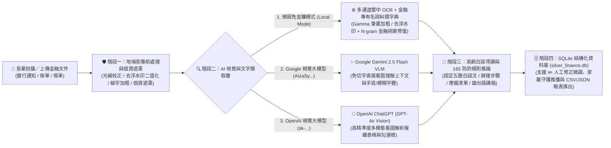

# 銀齡金融翻譯官：高齡者金融文件 AI 導讀與行動指引服務

---

## 一、系統架構與實作功能總覽

本專案採用 **React (Vite + Tailwind CSS)** 前端搭配 **Python (FastAPI + Pillow + SQLite + Hybrid AI OCR / VLM)** 後端，完整實作高齡金融文件導讀四大核心模組、6 個概念展示操作畫面與 SQLite 結構化辨識結果收集庫：

1. **模組一：拍照與影像前處理 (`backend/image_processor.py` & `CameraModal.jsx`)**
   - 支援手機／電腦相機即時取景（附綠色四角對齊框線引導）與相簿照片（JPG / PNG / WEBP）直接上傳。
   - 自動檢測照片亮度、對比度與清晰度（手震模糊時提示重新對焦拍攝；環境偏暗時自動啟動智慧補光與銳利化）。
   - **敏感個資不落地自動遮罩（PII Redaction）**：影像傳送雲端大模型前，先於地端自動遮罩身分證字號、銀行帳號與電話號碼，前端可一鍵切換檢視「個資遮罩圖層」。
2. **模組二：雙階段混合式 AI 解析與白話導讀 (`backend/ocr_engine.py` & `backend/ai_analyzer.py`)**
   - 產出高齡友善之「**固定五題白話格式**」：
     1. 這張單子是什麼？
     2. 要不要處理？期限到哪天？
     3. 要去哪裡、帶什麼？
     4. 哪裡要簽名？（在左側文件影像上自動用紅框標出簽名與期限位置）
     5. 有什麼要注意？
   - 分為「**白話導讀**（畫面 3）」、「**辦理步驟**（畫面 4，含地圖導航分行）」、「**應備資料**（畫面 5，出門前互動勾選檢查清單）」三個分頁。
   - 支援 **「✏️ 人工修正與重新解析導讀」**（`EditRecordModal.jsx` + `PUT /api/history/{record_id}`）：使用者可隨時修正 OCR 辨識原文並一鍵重新生成導讀，或直接手動微調標題、期限與五題問答，同步更新至 SQLite。
3. **模組三：防詐警示 (`backend/scam_detector.py` & `ScamQuickCheckerModal.jsx`)**
   - 內建 SQLite 詐騙關鍵字與異常要求比對規則庫（如：匯款至私人指定帳戶、催促 30 分鐘內匯款、要求切勿向銀行人員詢問、要求加私人 LINE、索取密碼／驗證碼、保證高報酬）。
   - 命中時直接呈現「**請先停下，確認後再行動**」警示畫面（畫面 6），提供 165 專線與「請家人協助確認」按鈕。
4. **模組四：語音朗讀與家屬守護 (`backend/family_guardian.py` & `FamilyGuardianModal.jsx`)**
   - 支援 **國語朗讀** 與 **台語口語導讀**（預設 0.82x 慢速朗讀適合長輩，並同步顯示即時口語字幕）。
   - **鐵三角防護（長輩操作、AI 解讀、家人把關）**：遇到高風險可疑文件自動推播至家屬守護端；家屬可在「家屬守護端看板」一鍵傳送安心回覆，長輩主畫面會即時顯示家人的叮嚀。
5. **步驟 04：SQLite 辨識結果收集庫 (`backend/history_store.py` & `HistoryVaultModal.jsx`)**
   - 每次辨識結果皆自動寫入後端 SQLite 關聯式資料庫（`backend/data/silver_finance.db`），支援分類篩選、關鍵字搜尋、單筆刪除、人工修正及 **CSV (Excel 可開) / JSON 報表匯出**。

---

## 二、多引擎金融文件 AI 辨識與導讀架構（本地金融詞典 OCR ＋ Gemini VLM ＋ ChatGPT Vision）

針對金融通知單常見的**「斜向防偽浮水印、彩色底紋、底線緊貼日期、細明體小字」**等辨識場景，本系統實作 **「本地多通道金融詞典 OCR ＋ Google Gemini 2.5 Flash VLM ＋ OpenAI ChatGPT (GPT-4o Vision)」** 三種可切換辨識引擎：



| 辨識引擎與機制 | 對應程式模組 | 核心優勢與解決痛點 | 啟用方式 |
| :--- | :--- | :--- | :--- |
| **1. 本地多通道 OCR ＋ 金融詞典糾錯** | `backend/ocr_engine.py` | 結合「小圖 Gamma 筆畫加粗」、「155 閾值去浮水印二值化」與「台灣金融專有名詞 N-gram 模糊糾錯字典（`_post_correct_financial_ocr`）」及官方網域識別（如 `@ctbcbank.com` → 中國信託商業銀行）。 | **預設自動啟用**（免填任何 API Key 即可直接上傳照片辨識）。 |
| **2. Google Gemini 2.5 Flash VLM** | `backend/ai_analyzer.py` (`call_gemini_vlm`) | **免除傳統 OCR 逐字切塊誤差**，直接將遮罩後影像輸入 Google 多模態模型，一步生成「固定五題白話問答」與「國／台語朗讀稿」。 | 於前台「防詐規則庫＆AI設定」填入 **Gemini API Key (`AIzaSy...`)** 即自動切換。 |
| **3. OpenAI ChatGPT (GPT-4o Vision)** | `backend/ai_analyzer.py` (`call_openai_vlm`) | 透過 OpenAI `gpt-4o` 多模態視覺模型直接看圖解析複雜金融單據、手寫批註與勾選框，強制輸出結構化 JSON 導讀結果。 | 於前台「防詐規則庫＆AI設定」填入 **OpenAI API Key (`sk-...`)** 即自動切換。 |
| **4. 人機協同微調機制 (Human-in-the-Loop)** | `EditRecordModal.jsx` + `PUT /api/history/{id}` | 針對極端反光、摺痕或手寫字跡，提供「修改 OCR 原文一鍵重新生成導讀」與「直接手動修改欄位」雙模式。 | 點選畫面右上角或紀錄卡上的 **「✏️ 修正辨識結果」** 即可即時修改並寫入 SQLite。 |

---

## 三、SQLite 關聯式資料庫設計 (`backend/data/silver_finance.db`)

後端透過 `backend/database.py` 建立標準 SQLite 關聯式資料庫，共包含 **4 張核心資料表**：

1. **`recognition_records`（文件辨識與五題導讀紀錄表）**：儲存每次上傳照片或範例之檔案資訊、發件機構、文件分類、辦理期限、五題白話問答（`q1_what_is_it` ~ `q5_important_notes`）、OCR 原文、個資遮罩文本與防詐判定結果。
2. **`family_guardians`（家屬守護網聯絡人資料表）**：儲存長輩綁定之家屬姓名、稱謂、電話與高風險自動推播設定。
3. **`family_notifications`（家屬防詐推播與雙向安心回覆紀錄表）**：記錄長輩分享或高風險自動觸發之推播通知，以及家屬傳回的安心叮嚀留言。
4. **`scam_rules`（165 防詐關鍵字與異常要求規則表）**：儲存六大高風險詐騙規則、嚴重等級、比對關鍵字與防詐解析說明。

---

## 四、快速啟動方式

### 方法一：一鍵啟動前後端
```bash
chmod +x start.sh
./start.sh
```

### 方法二：分別啟動後端與前端

1. **啟動 Python FastAPI 後端 (Port 8001)**：
   ```bash
   cd backend
   ./venv/bin/uvicorn main:app --host 127.0.0.1 --port 8001 --reload
   ```
2. **啟動 React 前端 (Port 5173)**：
   ```bash
   cd frontend
   npm run dev
   ```
3. 打開瀏覽器前往：**http://localhost:5173**
